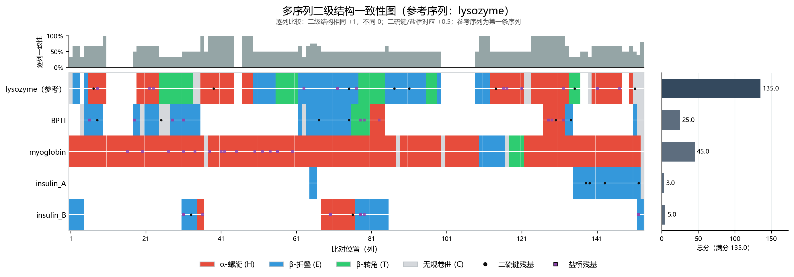

<p align="center">
  
</p>

<p align="center">
  
  
  
</p>

# protstruct

一个纯 Python、零第三方依赖的蛋白质结构特征分析包：读取 FASTA（1-20 条序列），
识别 **α-螺旋、β-折叠、β-转角**，预测 **二硫键** 与 **盐桥**，并给出多序列比对与一致度。

> 二级结构采用 Chou-Fasman 构象倾向因子法；二硫键与盐桥为序列层面的候选预测，
> 如需实验结构核验，可附加 PDB 文件（`--pdb`）。

## 功能一览

| 功能 | 说明 |
| --- | --- |
| FASTA 读取 | `.fa/.faa/.fasta`，1-20 条序列，支持多行序列、注释行、UTF-8/UTF-16/GBK 编码、重复 ID 自动编号 |
| 二级结构 | Chou-Fasman 法预测 α-螺旋(H)、β-折叠(E)、β-转角(T)、无规卷曲(C)，输出区段与占比 |
| 二硫键 | 自动识别全部 Cys，按环区长度等规则做最优配对（DP），输出成对位置与游离 Cys |
| 盐桥 | 在指定序列窗口内寻找 Asp/Glu–Lys/Arg/His 候选，按二级结构上下文打分 |
| 多序列比对 | center-star + Needleman-Wunsch（BLOSUM62、仿射空位），输出比对、共识与一致度矩阵 |
| 一致性评分 | 以第一条序列为参考逐列打分：二级结构相同 +1、不同 0，二硫键/盐桥对应 +0.5，输出 CSV |
| 一致性图 | 二级结构色块图 + 逐列一致率 + 各序列总分条形图 |
| 结构核验 | 可选 PDB：SG–SG ≤ 2.5 Å 判定二硫键，带电侧链原子 ≤ 4.0 Å 判定盐桥 |
| 报告输出 | text / markdown / json / csv，可直接重定向为文件 |

## 安装

要求 Python 3.8+，无任何第三方依赖。

```powershell
# 方式一：可编辑安装（推荐，安装后可直接使用 protstruct 命令）
pip install -e .

# 如需导出一致性图，再安装可选依赖 matplotlib
pip install -e ".[figure]"

# 方式二：不安装，直接在项目根目录运行
python -m protstruct examples/demo.fasta
```

## 快速开始

```powershell
# 默认文本报告
protstruct examples/demo.fasta

# 导出 Markdown / JSON / CSV
protstruct examples/demo.fasta -f markdown -o report.md
protstruct examples/demo.fasta -f json -o result.json
protstruct examples/demo.fasta -f csv -o summary.csv

# 两个结果：二级结构一致性图 + 一致性评分 CSV（只给一个参数也会自动推导另一个）
protstruct examples/demo.fasta --figure demo_consistency.png --scores demo_scores.csv
protstruct examples/demo.fasta --figure consistency.png

# 有晶体结构时核验真实二硫键与盐桥
protstruct examples/demo.fasta --pdb 1lyz.pdb

# 调整盐桥窗口、二硫键最短间隔、候选数量
protstruct examples/demo.fasta --salt-bridge-window 20 --min-disulfide-separation 5 --max-salt-bridges 12

# 跳过多序列比对
protstruct examples/demo.fasta --no-alignment
```

示例输出（`examples/demo.fasta`，5 条序列）：

```text
#  序列ID     长度  α-螺旋       β-折叠      β-转角      无规卷曲   Cys  二硫键  盐桥
-  ---------  ----  -----------  ----------  ----------  ---------  ---  ------  ----
1  lysozyme   129   39.5% (51)   31.8% (41)  21.7% (28)  7.0% (9)   8    4       8
2  BPTI       58    17.2% (10)   60.3% (35)  8.6% (5)    13.8% (8)  6    3       8
3  myoglobin  153   89.5% (137)  4.6% (7)    2.6% (4)    3.3% (5)   0    0       8
4  insulin_A  21    0.0% (0)     95.2% (20)  0.0% (0)    4.8% (1)   4    2       0
5  insulin_B  30    36.7% (11)   63.3% (19)  0.0% (0)    0.0% (0)   2    1       6
```

每条序列的详细结果还包含：

- 二级结构区段（如 `α-螺旋: 5-15, 27-38 …`）；
- 二硫键配对（如 `C64-C76(0.83, 高)`，括号内为启发式置信度）；
- 游离半胱氨酸；
- 盐桥候选（如 `K97-D101(高, α-螺旋 i,i+4)`）；
- 逐残基二级结构字符串（H/E/T/C）。

## 输入格式

```fasta
>lysozyme 鸡蛋清溶菌酶 P00698
KVFGRCELAAAMKRHGLDNYRGYSLGNWVCAAKFESNFNTQATNRNTDGSTDYGILQINSR
WWCNDGRTPGSRNLCNIPCSALLSSDITASVNCAKKIVSDGNGMNAWVAWRNRCKGTDVQAW
IRGCRL

>BPTI 牛胰蛋白酶抑制剂
RPDFCLEPPYTGPCKARIIRYFYNAKAGLCQTFVYGGCRAKRNNFKSAEDCMRTCGGA
```

- 标题行 `>` 后的第一个词作为序列 ID，其余作为描述；
- 支持 `.fa`、`.faa`、`.fasta` 扩展名（大小写不敏感，其他扩展名也会按 FASTA 尝试解析）；
- 自动识别 UTF-8（含 BOM）、UTF-16 与 GBK 编码；
- 支持多行序列，`;`、`#` 开头的行为注释；
- 支持 20 种标准氨基酸；`U→C`、`O→K`，`B/Z/J/X` 按模糊残基处理；
- 单文件最多 20 条序列，超过会给出明确错误提示。

## 命令行参数

| 参数 | 默认 | 说明 |
| --- | --- | --- |
| `fasta` | 必填 | 输入 FASTA 文件（1-20 条序列） |
| `-f, --format` | `text` | `text` / `markdown` / `json` / `csv` |
| `-o, --output` | 终端 | 输出文件（UTF-8） |
| `--pdb` | 无 | PDB 结构文件，用于核验真实二硫键与盐桥 |
| `--salt-bridge-window` | 25 | 盐桥候选的最大序列间隔 |
| `--min-disulfide-separation` | 4 | 二硫键配对的最短序列间隔 |
| `--max-salt-bridges` | 8 | 每条序列输出的盐桥候选上限 |
| `--no-alignment` | 关闭 | 跳过多序列比对 |
| `--figure` | 无 | 输出一致性图（.png/.svg/.pdf） |
| `--scores` | 无 | 输出一致性评分 CSV（UTF-8 BOM，可直接用 Excel 打开） |
| `--version` | — | 显示版本 |

## 一致性评分与图

### 评分规则

以 FASTA 中的**第一条序列为参考**，沿多序列比对的列逐列比较：

| 单元 | 得分 |
| --- | --- |
| 二级结构相同（H/H、E/E、T/T、C/C） | +1 |
| 二级结构不同 | 0 |
| 二硫键在比对列上对应 | +0.5 |
| 盐桥在比对列上对应 | +0.5 |
| 任一侧为 gap 的列 | 不参与比较 |

```
总分 = 二级结构一致数 × 1 + (二硫键匹配数 + 盐桥匹配数) × 0.5
```

参考序列与自身比较时，每一列都相同、所有二硫键/盐桥均匹配，因此总分等于参考满分
（序列长度 + 0.5 × 特征数）。

### 导出的 CSV

```powershell
protstruct examples/demo.fasta --scores scores.csv
```

| 列 | 含义 |
| --- | --- |
| 序号 / 序列ID | 序列在 FASTA 中的顺序与名称 |
| 总分 | 相对第一条序列的总分（核心结果） |
| 二级结构一致数 / 不一致数 | 逐列比较的匹配与不匹配残基数 |
| 二级结构一致率(%) | 一致数 / 可比残基数 |
| 二硫键匹配数 / 盐桥匹配数 | 在比对列上对应上的特征数 |
| 可比残基数 | 双方均非 gap 的列数 |
| 参考满分 | 参考序列长度 + 0.5 × 参考特征数 |

### 导出的图

```powershell
protstruct examples/demo.fasta --figure consistency.png
```

图中包含三部分：逐列主要二级结构的一致比例、按比对列排布的二级结构色块、
以及每条序列相对参考序列的总分条形图；黑点与紫色方块分别标记二硫键、盐桥残基。
`--figure` 支持 `.png`、`.svg`、`.pdf`，需要 matplotlib（`pip install "protstruct[figure]"`）。

示例：



## Python API

```python
from protstruct import AnalysisConfig, analyze_fasta

result = analyze_fasta("examples/demo.fasta", AnalysisConfig(salt_bridge_window=20))
item = result.items[0]

print(item.identifier, item.length)
print(item.ss)                              # H/E/T/C 逐残基字符串
print(item.counts())                        # {'H': 51, 'E': 41, 'T': 28, 'C': 9}
print(item.secondary_structure.regions[:3]) # Region(kind='H', start=5, end=15) ...
print([str(bond) for bond in item.disulfides.bonds])
print([str(bridge) for bridge in item.salt_bridges[:3]])

# 多序列比对
alignment = result.alignment
print(alignment.aligned)        # 等长的带 gap 序列
print(alignment.consensus)      # 逐列共识
print(alignment.identity)       # 两两一致度（%）

# 一致性评分与图
from protstruct import compute_consistency, plot_consistency, write_consistency_csv

consistency = compute_consistency(result)
print(consistency.scores[0].total, consistency.max_total)
write_consistency_csv(consistency, "scores.csv")
plot_consistency(result, consistency, "consistency.png")
```

单独调用预测函数：

```python
from protstruct.secondary_structure import predict_secondary_structure
from protstruct.disulfide import predict_disulfides
from protstruct.saltbridge import predict_salt_bridges

ss = predict_secondary_structure("ACDEFGHIKLMNPQRSTVWY")
bonds = predict_disulfides("ACDEFGHIKLMNPQRSTVWYCAC")
bridges = predict_salt_bridges("AEAAAKAAAD", ss="HHHHHHHHHH")
```

## 算法说明

- **二级结构（Chou-Fasman）**：6 残基窗口内 ≥4 个残基 Pa ≥ 1.03 成核，向两侧延伸至
  4 残基窗口均值 < 1.0；β-折叠以 5 窗口内 ≥3 个 Pb ≥ 1.05 成核；β-转角以 4 残基
  窗口 Pt 均值 ≥ 1.0 且高于 Pa/Pb 判定。螺旋与折叠重叠时按区段平均倾向裁决，
  脯氨酸强制中断螺旋，过短区段降级为无规卷曲。
- **二硫键**：以环区长度（偏好 5-15 残基）与是否位于螺旋区构造代价，在
  “先最大化成键对数、再最小化总代价”的目标下求解最优配对；Cys 超过 16 个时退化为贪心匹配。
- **盐桥**：仅在序列间隔窗口内寻找酸性-碱性残基对，按是否处于螺旋/折叠、
  间隔是否适合 i,i+4 等几何关系打分；结果为候选，不是真实成键判定。
- **多序列比对**：以 k-mer 相似度选出中心序列，逐条做 BLOSUM62 + 仿射空位全局比对，
  再合并为多序列比对。
- **PDB 核验**：解析 ATOM/HETATM 记录，同链内 SG–SG ≤ 2.5 Å 记为二硫键，
  Asp/Glu 的 OD/OE 与 Lys/Arg/His 的 NZ/NH/NE 原子距离 ≤ 4.0 Å 记为盐桥。

## 局限与注意事项

1. 二级结构、二硫键、盐桥均为**基于序列的预测**，不能替代实验解析（X-ray / NMR / cryo-EM）。
2. Chou-Fasman 属于经典统计方法，整体准确率有限；对短肽、膜蛋白、低复杂度序列尤其不敏感，
   长链全 α 蛋白可能高估螺旋比例。
3. 二硫键配对使用启发式评分，只保证“每个 Cys 至多参与一对”，不保证与真实拓扑一致；
   真实配对请使用 `--pdb`。
4. 盐桥必须在三维结构中才能确证，序列模式只能提供候选；PDB 模式目前只统计**同链内**接触。
5. 多序列比对为全局比对，适合长度相近或同源序列；序列数量上限为 20。

## 测试

```powershell
python -m unittest discover -s tests -v
```

覆盖 FASTA 解析与校验、二级结构输出、二硫键配对、盐桥窗口、比对完整性、
一致性打分与图、扩展名与编码兼容、四种报告格式、CLI 以及 PDB 结构解析，共 35 个用例。

## 目录结构

```text
protstruct/
├── protstruct/
│   ├── __init__.py            # 对外 API
│   ├── __main__.py            # python -m protstruct
│   ├── fasta.py               # FASTA 解析与校验（.fa/.faa/.fasta）
│   ├── secondary_structure.py # Chou-Fasman 二级结构预测
│   ├── disulfide.py           # 二硫键预测
│   ├── saltbridge.py          # 盐桥候选预测
│   ├── alignment.py           # 多序列比对
│   ├── consistency.py         # 一致性打分与 CSV
│   ├── figure.py              # 一致性图（matplotlib 可选）
│   ├── analysis.py            # 流程编排
│   ├── report.py              # text/markdown/json/csv 报告
│   ├── structure_io.py        # 可选 PDB 结构核验
│   └── cli.py                 # 命令行入口
├── examples/demo.fasta        # 5 条示例序列
├── docs/
│   ├── logo.svg               # 矢量 Logo
│   ├── logo.png               # README 用 Logo
│   └── consistency_example.png
├── tests/test_protstruct.py   # 单元测试
├── pyproject.toml
├── LICENSE
├── README.md
└── .gitignore
```

## 许可证

本项目采用 MIT License，详见 [LICENSE](LICENSE)。
