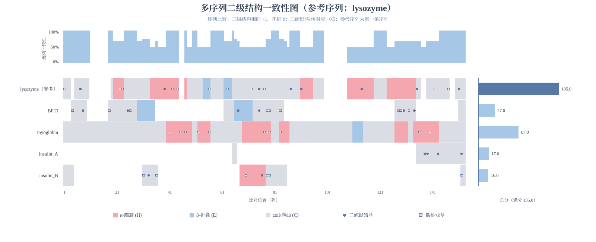

<p align="center">
  
</p>

<p align="center">
  
  
  
  <a href="https://github.com/rsj99-dev/protstruct"></a>
</p>

# protstruct

一个纯 Python、零第三方依赖的蛋白质结构特征分析包：读取 FASTA（1-20 条序列），
识别 **α-螺旋、β-折叠**（H/E/C 三态），预测 **二硫键** 与 **盐桥**，给出多序列比对、
二维一致性评分，并支持 **二级结构数据库检索**。

> 二级结构采用 GOR IV 信息论模型（gor5_4 + gor5_3，21 残基窗口；H/E/C 三态）；二硫键与盐桥为序列层面的候选预测，
> 如需实验结构核验，可附加 PDB 文件（`--pdb`）。

## 功能一览

| 功能 | 说明 |
| --- | --- |
| FASTA 读取 | `.fa/.faa/.fasta`，1-20 条序列，支持多行序列、注释行、UTF-8/UTF-16/GBK 编码、重复 ID 自动编号 |
| 二级结构 | GOR IV 信息论模型预测 α-螺旋(H)、β-折叠(E) 与 coil/卷曲(C)，输出区段与占比（三态模型，β-转角并入 C） |
| 二硫键 | 自动识别全部 Cys，按环区长度等规则做最优配对（DP），输出成对位置与游离 Cys |
| 盐桥 | 在指定序列窗口内寻找 Asp/Glu–Lys/Arg/His 候选，按二级结构上下文打分 |
| 多序列比对 | center-star + Needleman-Wunsch（BLOSUM62、仿射空位），输出比对、共识与一致度矩阵 |
| 一致性评分 | 以第一条序列为参考逐列打分：二级结构相同 +1、不同 0，二硫键/盐桥对应 +0.5，输出 CSV |
| 一致性图 | 二级结构色块图 + 逐列一致率 + 各序列总分条形图 |
| 数据库检索 | `protstruct-search`：GOR IV SS + k-mer 预筛 + SS Smith-Waterman，Rust 并行核心（可选） |
| 结构核验 | 可选 PDB：SG–SG ≤ 2.5 Å 判定二硫键，带电侧链原子 ≤ 4.0 Å 判定盐桥 |
| 报告输出 | text / markdown / json / csv，可直接重定向为文件 |

## 安装

要求 Python 3.8+，无任何第三方依赖。

```powershell
# 方式一：从 GitHub 克隆后安装（推荐）
git clone https://github.com/rsj99-dev/protstruct.git
cd protstruct/software
pip install -e .

# 如需导出一致性图，先构建 Rust SVG 绘图核心
cd rust/protstruct_plot
cargo build --release

# 方式二：不安装，直接在本目录运行
python -m protstruct examples/demo.fasta
```

## 快速开始

```powershell
# 默认文本报告
protstruct examples/demo.fasta

# 导出 Markdown / JSON / CSV
protstruct examples/demo.fasta -f markdown -o report.md
protstruct examples/demo.fasta -f json -o result.json
protstruct examples/demo.fasta -f csv -o summary.csv

# 两个结果：二级结构一致性图 + 一致性评分 CSV（只给一个参数也会自动推导另一个）
protstruct examples/demo.fasta --figure demo_consistency.svg --scores demo_scores.csv
protstruct examples/demo.fasta --figure consistency.svg

# 有晶体结构时核验真实二硫键与盐桥
protstruct examples/demo.fasta --pdb 1lyz.pdb

# 调整盐桥窗口、二硫键最短间隔、候选数量
protstruct examples/demo.fasta --salt-bridge-window 20 --min-disulfide-separation 5 --max-salt-bridges 12

# 跳过多序列比对
protstruct examples/demo.fasta --no-alignment
```

示例输出（`examples/demo.fasta`，5 条序列）：

```text
#  序列ID     长度  α-螺旋       β-折叠      coil/卷曲  Cys  二硫键  盐桥
-  ---------  ----  -----------  ----------  ---------  ---  ------  ----
1  lysozyme   129   32.6% (42)   4.7% (6)    62.8% (81) 8    4       8
2  BPTI       58    0.0% (0)     24.1% (14)  75.9% (44) 6    3       8
3  myoglobin  153   29.4% (45)   2.6% (4)    68.0% (104) 0   0       8
4  insulin_A  21    0.0% (0)     0.0% (0)    100.0% (21) 4   2       0
5  insulin_B  30    33.3% (10)   0.0% (0)    66.7% (20) 2   1       6
```

每条序列的详细结果还包含：

- 二级结构区段（如 `α-螺旋: 5-15, 27-38 …`）；
- 二硫键配对（如 `C64-C76(0.83, 高)`，括号内为启发式置信度）；
- 游离半胱氨酸；
- 盐桥候选（如 `K97-D101(高, α-螺旋 i,i+4)`）；
- 逐残基二级结构字符串（H/E/C）。

## 输入格式

```fasta
>lysozyme 鸡蛋清溶菌酶 P00698
KVFGRCELAAAMKRHGLDNYRGYSLGNWVCAAKFESNFNTQATNRNTDGSTDYGILQINSR
WWCNDGRTPGSRNLCNIPCSALLSSDITASVNCAKKIVSDGNGMNAWVAWRNRCKGTDVQAW
IRGCRL

>BPTI 牛胰蛋白酶抑制剂
RPDFCLEPPYTGPCKARIIRYFYNAKAGLCQTFVYGGCRAKRNNFKSAEDCMRTCGGA
```

- 标题行 `>` 后的第一个词作为序列 ID，其余作为描述；
- 支持 `.fa`、`.faa`、`.fasta` 扩展名（大小写不敏感，其他扩展名也会按 FASTA 尝试解析）；
- 自动识别 UTF-8（含 BOM）、UTF-16 与 GBK 编码；
- 支持多行序列，`;`、`#` 开头的行为注释；
- 支持 20 种标准氨基酸；`U→C`、`O→K`，`B/Z/J/X` 按模糊残基处理；
- 单文件最多 20 条序列，超过会给出明确错误提示。

## 命令行参数

| 参数 | 默认 | 说明 |
| --- | --- | --- |
| `fasta` | 必填 | 输入 FASTA 文件（1-20 条序列） |
| `-f, --format` | `text` | `text` / `markdown` / `json` / `csv` |
| `-o, --output` | 终端 | 输出文件（UTF-8） |
| `--pdb` | 无 | PDB 结构文件，用于核验真实二硫键与盐桥 |
| `--salt-bridge-window` | 25 | 盐桥候选的最大序列间隔 |
| `--min-disulfide-separation` | 4 | 二硫键配对的最短序列间隔 |
| `--max-salt-bridges` | 8 | 每条序列输出的盐桥候选上限 |
| `--no-alignment` | 关闭 | 跳过多序列比对 |
| `--figure` | 无 | 输出一致性 SVG 图（Rust 绘图核心） |
| `--scores` | 无 | 输出一致性评分 CSV（UTF-8 BOM，可直接用 Excel 打开） |
| `--version` | — | 显示版本 |

## 一致性评分与图

### 评分规则

以 FASTA 中的**第一条序列为参考**，沿多序列比对的列逐列比较：

| 单元 | 得分 |
| --- | --- |
| 二级结构相同（H/H、E/E、C/C） | +1 |
| 二级结构不同 | 0 |
| 结构特征列对相同（二硫键或盐桥，可跨类型） | +0.5 |
| 任一侧为 gap 的列 | 不参与比较 |

```
总分 = 二级结构一致数 × 1 + 结构特征匹配数 × 0.5
```

结构特征匹配按**比对列对**判断：将二硫键与盐桥的列对合并为集合，目标序列的列对只要出现在参考集合中即记一次；盐桥列对与二硫键列对相同时也算一次，同一列对不重复计分。

### 导出的 CSV

```powershell
protstruct examples/demo.fasta --scores scores.csv
```

| 列 | 含义 |
| --- | --- |
| 序号 / 序列ID | 序列在 FASTA 中的顺序与名称 |
| 总分 | 相对第一条序列的总分（核心结果） |
| 二级结构一致数 / 不一致数 | 逐列比较的匹配与不匹配残基数 |
| 二级结构一致率(%) | 一致数 / 可比残基数 |
| 二硫键匹配数 / 盐桥匹配数 | 同类型特征在比对列上对应上的数量 |
| 结构特征匹配数 | 二硫键/盐桥合并后的列对匹配数（可跨类型，用于总分） |
| 可比残基数 | 双方均非 gap 的列数 |
| 参考满分 | 参考序列长度 + 0.5 × 参考结构特征列对数 |

### 导出的图

```powershell
protstruct examples/demo.fasta --figure consistency.svg
```

图中包含三部分：逐列主要二级结构的一致比例、按比对列排布的二级结构色块、
以及每条序列相对参考序列的总分条形图；黑点与紫色方块分别标记二硫键、盐桥残基。
`--figure` 只接受 `.svg`，由 `software/rust/protstruct_plot` 的 Rust 核心生成，不需要 matplotlib。

示例：



## 数据库检索

```powershell
protstruct-search query.fa database.fa --top 20 --prefilter 2000
```

查询序列与数据库序列先由 GOR IV 预测二级结构，再按序列/SS k-mer 预筛，候选序列执行
二级结构 Smith-Waterman；输出 TSV 包含排名、SS 得分、SS 一致率、覆盖度与序列相似度。
Rust 核心源码位于 `rust/protstruct_search`，构建后自动启用；无二进制时使用 Python 回退。

```powershell
cd rust/protstruct_search
cargo build --release
```

## 可选 GOR V 引擎（gor5_1）

默认 API 使用 GOR IV 的 `gor5_4 + gor5_3` 21 残基模型；需要 GOR V 的轻量 13 残基评分时：

```python
from protstruct.secondary_structure import predict_secondary_structure
result = predict_secondary_structure(sequence, engine="gor_v")
```

Rust 版可批量预测 FASTA：

```powershell
cd rust/protstruct_gorv
cargo build --release
target\release\protstruct-gorv --model-dir ../../protstruct/data --input ../../examples/demo.fasta
```

该命令输出 FASTA 风格的 `>id` 与 H/E/C 字符串；需要本地 Rust 工具链。

## Python API

```python
from protstruct import AnalysisConfig, analyze_fasta

result = analyze_fasta("examples/demo.fasta", AnalysisConfig(salt_bridge_window=20))
item = result.items[0]

print(item.identifier, item.length)
print(item.ss)                              # H/E/C 逐残基字符串
print(item.counts())                        # {'H': 42, 'E': 6, 'C': 81}
print(item.secondary_structure.regions[:3]) # Region(kind='H', start=5, end=15) ...
print([str(bond) for bond in item.disulfides.bonds])
print([str(bridge) for bridge in item.salt_bridges[:3]])

# 多序列比对
alignment = result.alignment
print(alignment.aligned)        # 等长的带 gap 序列
print(alignment.consensus)      # 逐列共识
print(alignment.identity)       # 两两一致度（%）

# 一致性评分与图
from protstruct import compute_consistency, plot_consistency, write_consistency_csv

consistency = compute_consistency(result)
print(consistency.scores[0].total, consistency.max_total)
write_consistency_csv(consistency, "scores.csv")
plot_consistency(result, consistency, "consistency.svg")
```

单独调用预测函数：

```python
from protstruct.secondary_structure import predict_secondary_structure
from protstruct.disulfide import predict_disulfides
from protstruct.saltbridge import predict_salt_bridges

ss = predict_secondary_structure("ACDEFGHIKLMNPQRSTVWY")
bonds = predict_disulfides("ACDEFGHIKLMNPQRSTVWYCAC")
bridges = predict_salt_bridges("AEAAAKAAAD", ss="HHHHHHHHHH")
```

## 算法说明

- **二级结构（GOR IV）**：默认使用随包发布的 `gor5_4_21.bin` 与 `gor5_3_21.bin`（Matrix6D + Matrix4D，21 残基窗口）；按 6D 对数比累加并用 GOR III 项校正，取 H/E/C 最大状态；脯氨酸置为卷曲，过短区段降级为卷曲。模型来自 MIT 许可的 GOR-Algorithm 实现。
- **可选 GOR V（gor5_1）**：`predict_secondary_structure(..., engine="gor_v")` 使用 13 残基的 `gor5_1` 基础模型，适合轻量场景。
- **二硫键**：以环区长度（偏好 5-15 残基）与是否位于螺旋区构造代价，在
  “先最大化成键对数、再最小化总代价”的目标下求解最优配对；Cys 超过 16 个时退化为贪心匹配。
- **盐桥**：仅在序列间隔窗口内寻找酸性-碱性残基对，按是否处于螺旋/折叠、
  间隔是否适合 i,i+4 等几何关系打分；结果为候选，不是真实成键判定。
- **多序列比对**：以 k-mer 相似度选出中心序列，逐条做 BLOSUM62 + 仿射空位全局比对，
  再合并为多序列比对。
- **数据库检索**：GOR IV 预测 H/E/C 后，以序列/SS k-mer Jaccard 预筛，再对候选做 SS Smith-Waterman 局部比对；Rust 核心使用 Rayon 并行，缺失时自动回退 Python。
- **PDB 核验**：解析 ATOM/HETATM 记录，同链内 SG–SG ≤ 2.5 Å 记为二硫键，
  Asp/Glu 的 OD/OE 与 Lys/Arg/His 的 NZ/NH/NE 原子距离 ≤ 4.0 Å 记为盐桥。

## 局限与注意事项

1. 二级结构、二硫键、盐桥均为**基于序列的预测**，不能替代实验解析（X-ray / NMR / cryo-EM）。
2. GOR IV 在本实现中采用 `gor5_4 + gor5_3`（21 残基窗口），单序列模式未使用同源比对；
   三态模型将 β-转角并入 C/coil（不再单列 T），对短肽、膜蛋白和低复杂度序列可能出现偏差。
3. 二硫键配对使用启发式评分，只保证“每个 Cys 至多参与一对”，不保证与真实拓扑一致；
   真实配对请使用 `--pdb`。
4. 盐桥必须在三维结构中才能确证，序列模式只能提供候选；PDB 模式目前只统计**同链内**接触。
5. 多序列比对为全局比对，适合长度相近或同源序列；序列数量上限为 20。
6. 数据库检索以二级结构相似度为核心；Rust 核心需本地工具链构建，Python 回退速度有限。

## 测试

```powershell
python -m unittest discover -s tests -v
```

覆盖 FASTA 解析与校验、GOR IV 预测、二硫键配对、盐桥窗口、比对完整性、数据库检索、
一致性打分与图、扩展名与编码兼容、四种报告格式、CLI 以及 PDB 结构解析，共 37 个用例。

## 目录结构

```text
software/
├── protstruct/
│   ├── __init__.py            # 对外 API
│   ├── __main__.py            # python -m protstruct
│   ├── fasta.py               # FASTA 解析与校验（.fa/.faa/.fasta）
│   ├── gor_v.py               # 可选 GOR V（gor5_1）预测
│   ├── gor_v_iv.py            # 默认 GOR IV（gor5_4 + gor5_3，21 窗口）
│   ├── secondary_structure.py # 二级结构接口（H/E/C）
│   ├── disulfide.py           # 二硫键预测
│   ├── saltbridge.py          # 盐桥候选预测
│   ├── alignment.py           # 多序列比对
│   ├── consistency.py         # 一致性打分与 CSV
│   ├── search.py              # 二级结构数据库检索
│   ├── figure.py              # Rust SVG 一致性图入口
│   ├── analysis.py            # 流程编排
│   ├── report.py              # text/markdown/json/csv 报告
│   ├── structure_io.py        # 可选 PDB 结构核验
│   ├── data/                  # GOR IV/V 模型（MIT）
│   └── cli.py                 # 命令行入口
├── rust/protstruct_search/    # Rust 并行搜索核心（源码）
├── rust/protstruct_gorv/      # Rust GOR IV 预测核心（源码）
├── examples/demo.fasta        # 5 条示例序列
├── docs/
│   ├── logo.svg               # 矢量 Logo
│   ├── logo.png               # README 用 Logo
│   └── consistency_example.svg
├── tests/test_protstruct.py   # 单元测试
├── pyproject.toml
├── LICENSE
└── README.md
```

`software/` 可独立作为代码包发布；论文稿、论文图与复现包（数据、脚本、输出）位于项目根目录的 `../manuscript/`。

## 许可证

本项目采用 MIT License，详见 [LICENSE](LICENSE)。
